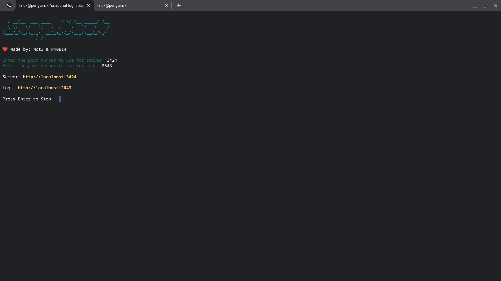
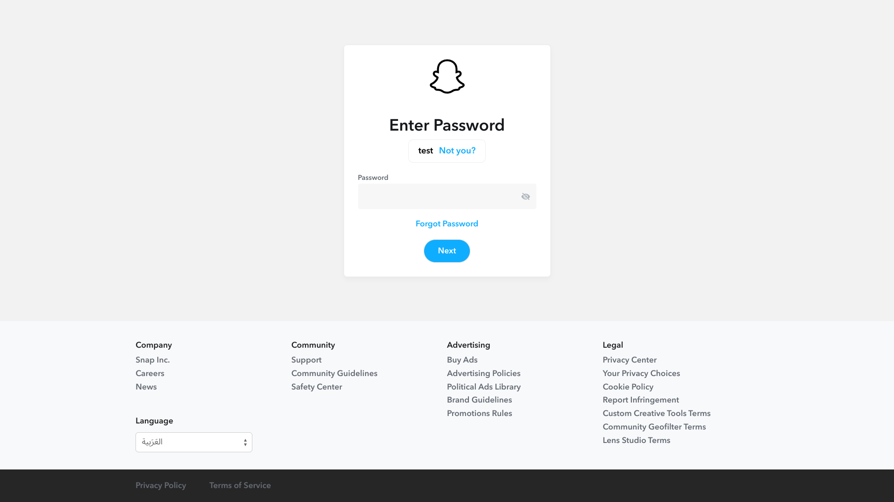
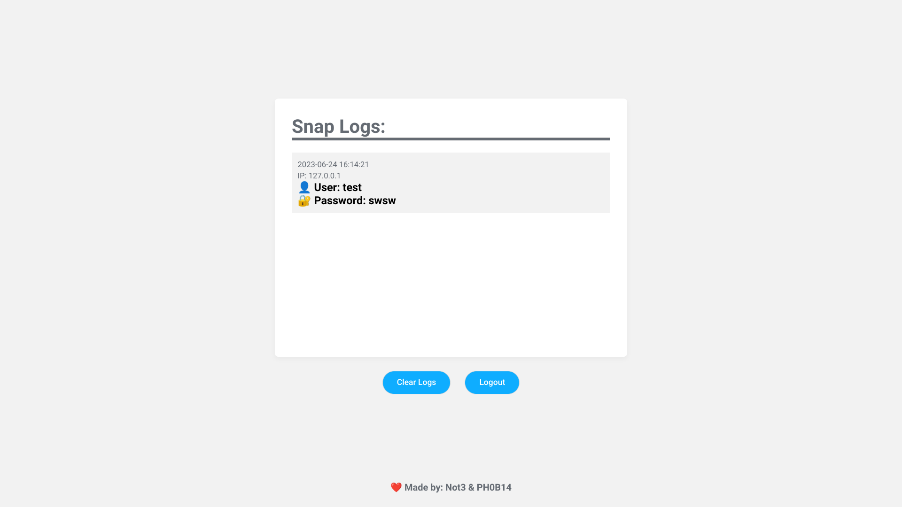

//github.com/user-attachments/assets/30569090-0c43-4739-9d99-cedea7f106e2)
# Snap.Hack

<pre>
   ____                 __ __         __ 
  / __/__  ___ ____    / // /__ _____/ /__ 
 _\ \/ _ \/ _ `/ _ \_ / _  / _ `/ __/  '_/ 
/___/_//_/\_,_/ .__(_)_//_/\_,_/\__/_/\_\ 
             /_/
</pre>

Snapchat phishing website in php

the admin password is "123" and can be changed in the index.php file in the snaps/logs folder.

to run and install this use these steps:

git clone https://github.com/TH3-PH0B14/Snap.Hack

cd Snap.Hack

sudo bash main.sh

then the program should work.

## Terminal Screen

## username page

## password page

## log login page

## log panel page

## Made by Not3 & PH0B14

Dont use for bad 😉

